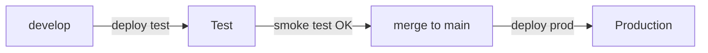

# Deploying our instance (homelab)

How the running instance of this repo is built, deployed and updated. The generic, provider-independent guide is [DEPLOYMENT.md](DEPLOYMENT.md); this file is the concrete setup on our Docker host `docker01`.

| | Test | Production |
|---|---|---|
| URL | https://wunschzettu-test.int.gruee.dev (internal only) | https://wunschzettu.gruee.dev (Cloudflare Tunnel) |
| Git branch | `develop` | `main` |
| Source on the host | `/opt/src/wunschzettu-test` | `/opt/src/wunschzettu` |
| Stack (compose + `.env` + `data/`) | `/opt/stacks/wunschzettu-test` | `/opt/stacks/wunschzettu` |
| Container / image | `wunschzettu-test` / `wunschzettu:test` | `wunschzettu` / `wunschzettu:latest` |

Both run from the same code and Dockerfile. They differ only in `.env`, `data/` (separate databases) and host name. The test instance sends **real mails** through the same mail provider.



## Release flow

1. Work on a feature branch, merge into `develop`, push.
2. Deploy to test:
   ```sh
   ssh docker01 /opt/stacks/scripts/wunschzettu-deploy.sh test
   ```
3. Check https://wunschzettu-test.int.gruee.dev. Run the smoke test from [DEPLOYMENT.md §7](DEPLOYMENT.md#7-smoke-test) (login mail arrives, reservation stays hidden from the list owner).
4. Merge `develop` into `main`, push.
5. Deploy to production:
   ```sh
   ssh docker01 /opt/stacks/scripts/wunschzettu-deploy.sh prod
   ```
6. Check `https://wunschzettu.gruee.dev/healthz` (`Healthy`) and that the log has no warnings about `App:BaseUrl`, `App:Operator` or SMTP:
   ```sh
   docker logs wunschzettu 2>&1 | grep -iE 'operator|smtp|baseurl'
   ```

What the script does: `git fetch` and fast-forward of the right branch in `/opt/src/...`, then `docker compose up -d --build` in the stack and an image prune. Migrations run on app start. Before that the app copies the database to `data/wunschzettu-before-update-<time>.db`; delete it once the update is fine.

Dockge (https://dockge.int.gruee.dev) shows both stacks: logs, start/stop and the `.env` editor. Its *Deploy* button does **not** rebuild the image, so use the script for new code. Restarting after an `.env` change: *Deploy* in Dockge or `docker compose up -d` in the stack (a plain `restart` does not re-read `.env`).

## Rolling back

Revert in git, so that the repo stays the single source of truth (the deploy script always fast-forwards to `origin/<branch>`, so a local `git reset` on the host would be undone by the next run):

```sh
git revert <bad-commit>       # on your machine, on main (or develop for test)
git push
ssh docker01 /opt/stacks/scripts/wunschzettu-deploy.sh prod
```

A migration that already ran is not undone. If the update broke data, restore from `data/wunschzettu-before-update-<time>.db` or the daily backup (restore steps in [DEPLOYMENT.md §8](DEPLOYMENT.md#8-backups)).

## Configuration

Settings live in `/opt/stacks/<stack>/.env` (mode 600, never in git; the stack repo only has `.env.example`). Keys are listed in [DEPLOYMENT.md §3](DEPLOYMENT.md#3-composeyaml-and-env). Mail is sent through Resend (SMTP `smtp.resend.com:587`, user `resend`, password = API key, EU region); the sender domain `wunschzettu.gruee.dev` is verified there.

## How traffic arrives

- **Production:** Cloudflare → tunnel `docker01` → `caddy:8080` → `wunschzettu:8080`. The container sits on the Docker network `public`. Caddy replaces `X-Forwarded-For` with Cloudflare's `CF-Connecting-IP`, because the app rate-limits logins per client IP, and sets HSTS.
- **Test:** LAN/VPN → Caddy `:443` (wildcard certificate `*.int.gruee.dev`) → `wunschzettu-test:8080` on the network `proxy`.
- No container publishes a port on the host.

The Caddy routes live in the `homelab-stacks` repo (`caddy/Caddyfile`). Do not use `sed -i` on that file (it is a single-file bind mount and would break); edit in place and run `docker exec caddy caddy reload --config /etc/caddy/Caddyfile`.

## First-time setup of a host

Only needed on a new machine:

```sh
# deploy key, read-only on GitHub (Settings → Deploy keys), plus an ssh alias
ssh-keygen -t ed25519 -N '' -f ~/.ssh/id_wunschzettu
printf 'Host github-wunschzettu\n  HostName github.com\n  User git\n  IdentityFile ~/.ssh/id_wunschzettu\n  IdentitiesOnly yes\n' >> ~/.ssh/config

git clone github-wunschzettu:giaenuuu/wunschzettu.git /opt/src/wunschzettu
git clone -b develop github-wunschzettu:giaenuuu/wunschzettu.git /opt/src/wunschzettu-test

# per stack: compose.yaml and .env.example come from the homelab-stacks repo
cp /opt/stacks/wunschzettu/.env.example /opt/stacks/wunschzettu/.env && chmod 600 /opt/stacks/wunschzettu/.env
# fill in the .env, then:
/opt/stacks/scripts/wunschzettu-deploy.sh prod
```

The container runs as user `1000:1000` and needs a `data/` folder it can write to (`chown 1000:1000 data`). Then add the Caddy route and the tunnel public hostname (Cloudflare → Zero Trust → Tunnels → `docker01` → Public Hostname → `http://caddy:8080`).

## Backups

The app copies its database to `data/backups/` daily (7 kept). Backrest backs up `/opt/stacks` to Cloudflare R2 nightly. The privacy policy promises off-site copies for **at most 30 days**, so the Wunschzettu data needs its own Backrest plan with that retention. The containers must be stopped during the snapshot (Backrest hooks `docker stop` / `docker start` the two container names).

## Troubleshooting

| Symptom | Check |
|---|---|
| 502 from Caddy | `docker ps` and `docker logs wunschzettu[-test]`. Normal before the first build |
| `unable to open database` | `data/` is not owned by `1000:1000` |
| Everyone shares one login limit | The `header_up X-Forwarded-For` line is missing in the Caddy block |
| Login mail does not arrive | Resend dashboard (*Emails*), DNS verification of the sender domain, `docker logs … \| grep -i smtp` |
| Everyone is signed out after a restore | `data/keys/` was missing from the backup |
